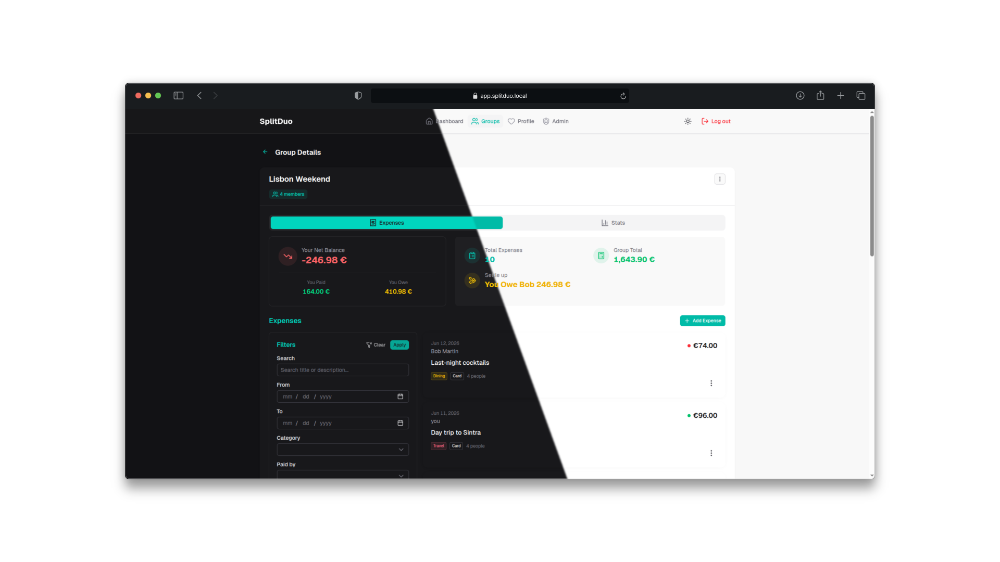
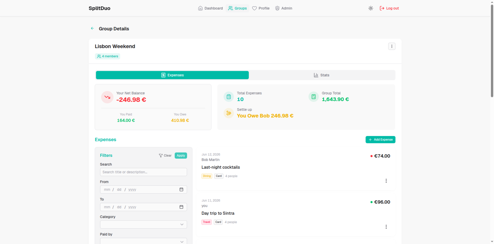
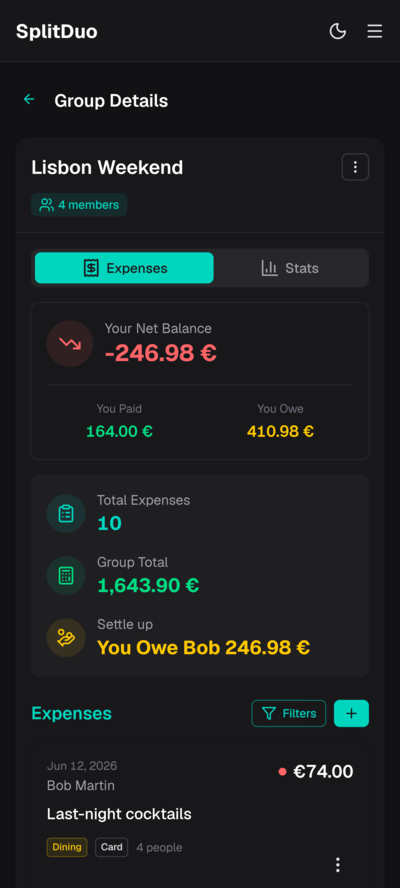

<p align="center">
  
</p>

# SplitDuo

[](https://gitlab.com/j1mm0/splitduo/-/pipelines)
[](https://gitlab.com/j1mm0/splitduo/-/graphs/main/charts)
[](https://gitlab.com/j1mm0/splitduo/-/releases)
[](https://hub.docker.com/r/j1mm0/splitduo)
[](LICENSE)

Self-hosted expense splitting for couples, housemates, and travel companions. One Docker container (amd64 and arm64), your own PostgreSQL, no subscription and no vendor account.

**Canonical repository:** [gitlab.com/j1mm0/splitduo](https://gitlab.com/j1mm0/splitduo) — development, issues, and releases happen here. [github.com/c4mbr0nn3/splitduo](https://github.com/c4mbr0nn3/splitduo) is a read-only mirror; please file issues and merge requests on GitLab.

[Website](https://splitduoapp.netlify.app) · [Docs](https://splitduoapp.netlify.app/getting-started) · [Changelog](https://splitduoapp.netlify.app/changelog) · [Comparison](https://splitduoapp.netlify.app/#compare) · [FAQ](https://splitduoapp.netlify.app/#faq)

<p align="center">
  
</p>

## Contents

- [Why SplitDuo](#why-splitduo)
- [Features](#features)
- [How it compares](#how-it-compares)
- [Screenshots](#screenshots)
- [Requirements](#requirements)
- [Quick start](#quick-start)
- [Running in production](#running-in-production)
- [Project status](#project-status)
- [Tech stack](#tech-stack)
- [Documentation](#documentation)
- [Release candidates](#release-candidates)
- [Contributing](#contributing)
- [Support](#support)
- [Security](#security)
- [License](#license)

## Why SplitDuo

Splitting expenses usually means a SaaS account, a subscription, or a Nextcloud instance. SplitDuo is none of those: it is one container next to a PostgreSQL database you already control, so the records of who paid for the rental car never leave your server.

It is built for two people or a small group — a couple, a flat, a trip — where everyone wants the same answer to "who owes whom" and nobody wants to keep a spreadsheet.

## Features

- **Flexible splits** — equal, exact amounts, proportional shares, or a custom breakdown, with live net balances per group.
- **Settlement suggestions** — group debts are collapsed into the fewest transfers needed to settle up.
- **Recurring expenses** — templates with weekly, monthly, or custom schedules. Pause them and choose whether to backfill or skip missed periods on resume; optionally require approval before generated expenses hit group balances.
- **Alias mode** — group members into named aliases (a couple sharing one slot, a household treated as a unit) and split by subgroup. Balances settle at the alias level.
- **Group statistics** — category, monthly, and per-member charts for each group.
- **Receipt scanning** — a photo of a receipt prefills amount, date, and category, and the image is attached to the expense. Works with any OpenAI-compatible endpoint. *Needs AI configuration.*
- **Expense attachments** — receipts, invoices, or any file, stored with the expense and downloadable later.
- **Import and export** — Cospend, Splitwise, and SplitDuo CSV, including a dedicated format for alias-mode groups. Export at any time; no lock-in.
- **Email invitations** — time-limited invite links; the other person needs no account until they accept. *Needs SMTP and `SD_BASE_URL`.*
- **Email notifications** — invitations, new expenses, group changes, 2FA codes, and password resets, in English and Italian. *Needs SMTP.*
- **Two-factor authentication** — TOTP with backup codes, enabled per user.
- **Installable PWA** — mobile-first interface that can be added to a phone or desktop home screen.
- **Two languages** — English and Italian, per-user preference, with locale parity enforced at build time.
- **Admin panel** — user and invitation management with role-based access.

Items marked *Needs …* are optional and configured through environment variables; see [Configuration](docs/readme/configuration.md).

## How it compares

| Capability | SplitDuo | Splitwise | Cospend |
| --- | --- | --- | --- |
| Open source | Yes | No | Yes |
| Self-hosted | Yes | No | Needs Nextcloud |
| Free | Yes | Freemium | Yes |
| No vendor account required | Yes | No | Yes |
| AI receipt scanning | Yes | Pro only | No |
| Mobile app | PWA | Native | No |
| CSV import and export | Yes | Export only | Yes |
| Two-factor authentication | Yes | Fingerprint only | Via Nextcloud |
| Multi-language | Yes | Yes | Yes |

[Full comparison](https://splitduoapp.netlify.app/#compare) · SplitDuo is not affiliated with Splitwise or Cospend.

## Screenshots

<p align="center">
  
  
</p>

<p align="center"><sub>The same group on desktop (light) and mobile (dark).</sub></p>

## Requirements

- **Docker with Compose v2** — the commands below use `docker compose`. The bundled file relies on `depends_on: condition: service_healthy`, which legacy `docker-compose` v1 does not handle the same way.
- **`linux/amd64` or `linux/arm64`** — every image tag is published as a multi-architecture manifest, so the same tag runs on x86 servers, ARM NAS boxes, and Raspberry Pi boards (64-bit OS).
- **Roughly 1 GB RAM and 10 GB disk** for a household. Attachments and database growth are what consume disk over time.
- **A reverse proxy for TLS** whenever the instance is reachable from anywhere but localhost — the app serves HTTP and does not terminate TLS itself.
- **PostgreSQL** is included in the compose stack. Pointing at an external database is optional (`SD_DB_*` variables).

## Quick start

The commands assume a POSIX shell (macOS, Linux, or WSL).

```bash
git clone https://gitlab.com/j1mm0/splitduo.git
cd splitduo
printf 'SD_INITIAL_USER_PASSWORD=%s\nSD_JWT_SECRET_KEY=%s\n' \
  "$(openssl rand -base64 24)" "$(openssl rand -base64 48)" > .env
docker compose up -d
```

Open `http://localhost:3000` and log in as `admin@splitduo.local` with the password in `.env` (`grep SD_INITIAL_USER_PASSWORD .env`).

> **Set both secrets before the first start.** Compose reads them from `.env`. `SD_INITIAL_USER_PASSWORD` only seeds the admin user on first boot — later changes belong in the admin panel. `SD_JWT_SECRET_KEY` also derives the key that encrypts TOTP secrets, so changing it after someone has enrolled in two-factor auth invalidates their authenticator until they use a backup code or re-enrol. Generate it once and keep it.

`:latest` tracks the newest stable release. On a server you do not babysit, pin a version instead: replace the `image:` line with a tag from [Releases](https://gitlab.com/j1mm0/splitduo/-/releases), for example `j1mm0/splitduo:1.16.0`.

## Running in production

- **Terminate TLS in front of the app.** SplitDuo speaks plain HTTP. Put it behind a reverse proxy that handles HTTPS and security headers, and never expose the container directly to the internet — see [Running on a server](docs/self-hosting.md#running-on-a-server-not-just-localhost). This is also required for camera-based receipt scanning: browsers only grant camera access on secure origins (localhost being the exception).
- **Set `SD_BASE_URL`** to your public URL so invitation, password-reset, and notification links point at your domain rather than localhost.
- **Back up the volumes.** Both `postgres_data` and `app_logs` hold state; the database dump and restore commands are in [Where your data lives](docs/self-hosting.md#where-your-data-lives).
- **Upgrade deliberately.** Pull the new image with `docker compose pull` and recreate with `docker compose up -d` — after taking a backup.
- **Behind a proxy, set `SD_KNOWN_PROXIES`** or per-IP rate limiting will see only the proxy's address and collapse into one shared bucket; see [Per-IP rate limiting behind a proxy](docs/self-hosting.md#per-ip-rate-limiting-behind-a-proxy).
- **Monitor `/health`** (readiness, includes the database) and `/health/live` (liveness, no database access); a system admin token unlocks `/health/details` for a full per-check report.

The full walkthrough — secrets, proxy options, health endpoints, optional AI and SMTP setup, troubleshooting — is the [self-hosting guide](docs/self-hosting.md).

## Project status

SplitDuo is actively maintained by a single maintainer, with no company or hosted offering behind it. Releases follow semantic versioning; 1.x is stable for household and small-group use, but read the release notes before upgrading, because minor versions can change behaviour. Security fixes are shipped on the latest stable release only. Support is best-effort — there is no SLA.

## Tech stack

| Layer | Technology |
| --- | --- |
| Backend | .NET 10, Entity Framework Core 10 |
| Frontend | Vue 3, Nuxt 4, Nuxt UI v4, TailwindCSS v4, TypeScript |
| Database | PostgreSQL 17 |
| Deployment | Single Docker container, multi-stage build, `linux/amd64` + `linux/arm64` |

The frontend is compiled to static files and served by the .NET backend, so the app and API share one origin and one port. TLS still belongs in front of it.

## Documentation

Rendered from this repository: [Getting started](https://splitduoapp.netlify.app/getting-started) · [Changelog](https://splitduoapp.netlify.app/changelog).

### Setup and operations

- [Self-hosting with Docker](docs/self-hosting.md) — deploy in 5 minutes
- [Configuration](docs/readme/configuration.md) — environment variable reference
- [Development](docs/readme/development.md) — local setup, migrations, dev services
- [Testing](docs/readme/testing.md) — unit, integration, and frontend tests, coverage
- [Releasing](docs/readme/releasing.md) — version bumps and changelog generation

### Architecture and design

- [Project specification](docs/project-spec.md)
- [System architecture](docs/architecture/system-architecture.md)
- [Backend architecture](docs/architecture/backend-architecture.md)
- [Frontend architecture](docs/architecture/frontend-architecture.md)
- [CI/CD pipeline](docs/ci-cd-pipeline.md)

### Feature documentation

- [2FA implementation](docs/features/2fa-implementation.md)
- [CSV import](docs/features/csv-import.md)
- [Invitation system](docs/features/invitation-system.md)
- [Receipt scanning](docs/features/receipt-scan/receipt-scan.md)
- [PWA](docs/features/pwa.md)
- [User settings](docs/features/user-settings.md)
- [Platform admin role management](docs/features/platform-admin-role-management.md)
- [Member role management](docs/features/member-role-management.md)
- [Adding a language (i18n)](docs/features/i18n/adding-a-language.md)

### API

- [OpenAPI specification](docs/api/splitduoapi-v1.yaml) — base URL `http://localhost:3000/api/v1`
- When running the backend in Development, the interactive Scalar reference is at `http://localhost:8080/scalar/v1`

## Release candidates

Release candidates are pre-release builds for testing upcoming changes. They are not stable, and they are not recommended for production or for data you care about.

Point the `image:` line at the `rc` tag — always the newest candidate — or at an immutable tag such as `j1mm0/splitduo:1.17.0-rc.1`, then `docker compose up -d`. `latest` always tracks the newest stable release, and candidates are never published as releases.

## Contributing

Contributions are welcome: bug reports, translations, documentation fixes, and code. Development happens on GitLab — the GitHub repository is a read-only mirror and does not accept pull requests.

- Read [CONTRIBUTING.md](CONTRIBUTING.md) before opening an issue or merge request.
- Local setup and project conventions: [Development](docs/readme/development.md). Test commands: [Testing](docs/readme/testing.md).
- Issues and merge requests use the templates in [.gitlab/](.gitlab/).
- Adding a UI language: [Adding a language](docs/features/i18n/adding-a-language.md).

## Support

- **Documentation first** — the [self-hosting guide](docs/self-hosting.md) covers most deployment questions, and the [website FAQ](https://splitduoapp.netlify.app/#faq) covers the product ones.
- **Bugs and feature requests** — open an issue on [GitLab](https://gitlab.com/j1mm0/splitduo/-/issues) using the issue template.
- **Security problems** — report them privately, never in a public issue. See [SECURITY.md](SECURITY.md).
- **No chat channel and no SLA** — this is a side project, answered on a best-effort basis.

## Security

Report vulnerabilities privately per [SECURITY.md](SECURITY.md). Before exposing an instance, set both secrets, terminate TLS at a reverse proxy, and configure backups.

## License

[MIT](LICENSE) © 2025 Francesco Zorzi. SplitDuo is not affiliated with Splitwise or Cospend.
