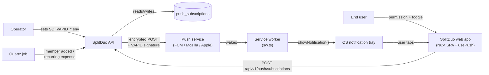
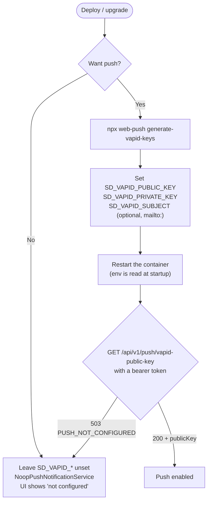
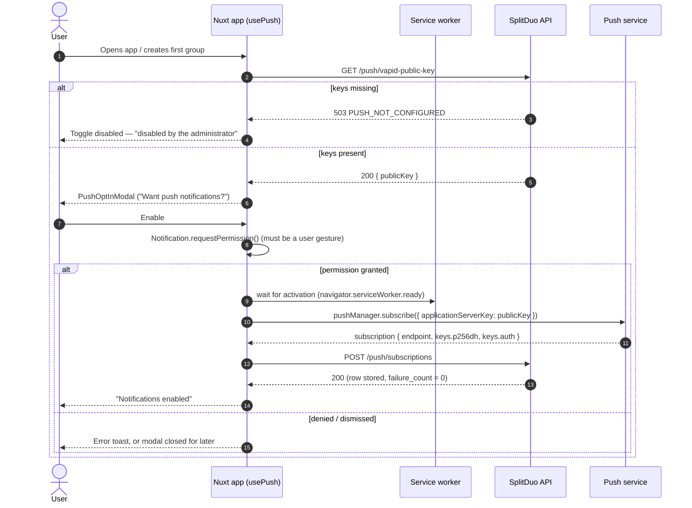
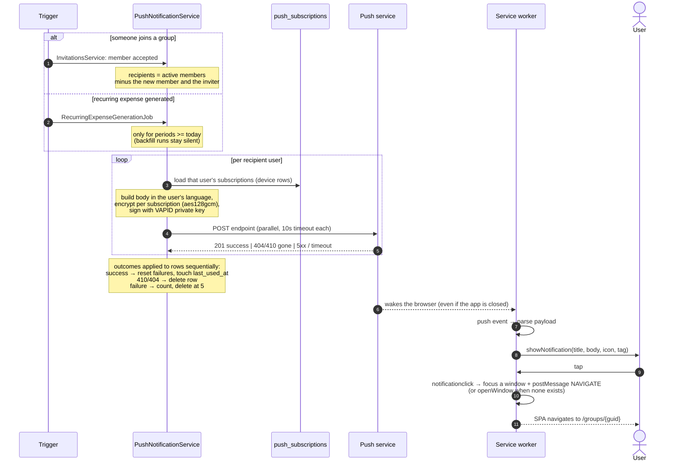
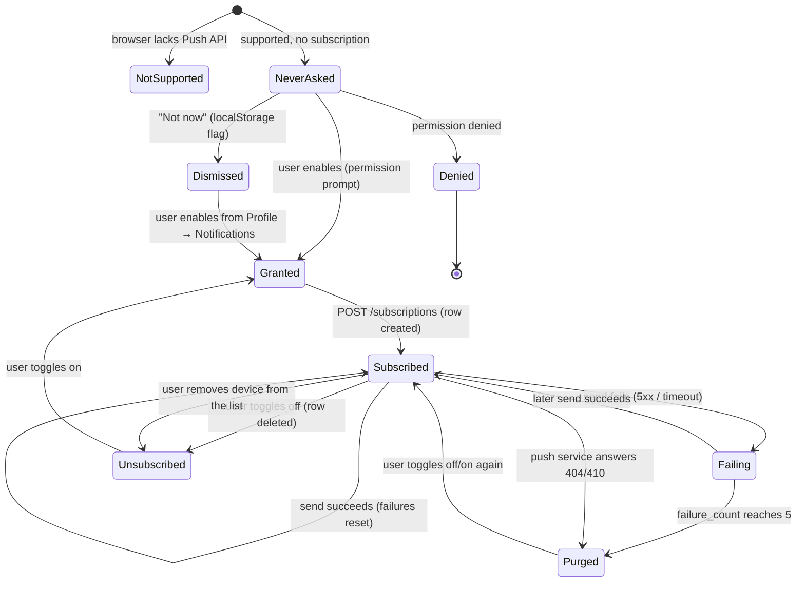
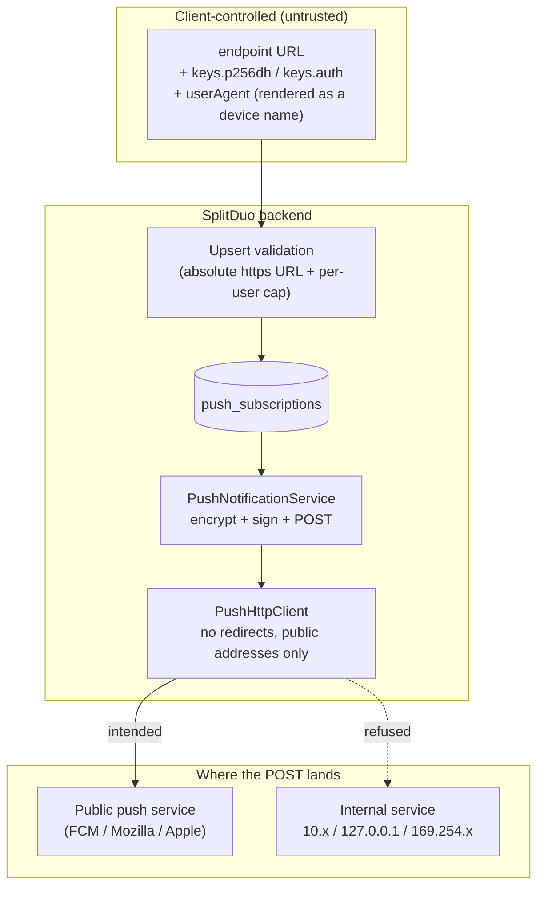

# Push Notifications — Feature Overview

Web Push notifications for SplitDuo: the browser receives a notification even when the
app is closed, with no third-party service in the middle. The backend talks to the
browser vendor's push service (FCM, Mozilla autopush, Apple) using **VAPID** keys it
generates itself.

This document explains the feature in plain terms: who the actors are, how a message
travels from a backend event to a notification on a phone, how a user turns it on, and
where the security boundary sits. Operator-facing setup steps live in
[`../self-hosting.md`](../self-hosting.md); manual test recipes live in
[`push-notifications-testing.md`](push-notifications-testing.md).

---

## 1. The one-paragraph version

A browser that "subscribes" to push creates a **subscription**: a URL at the browser
vendor's push service plus two encryption keys. The frontend sends that subscription to
our API, which stores it. When something happens (someone joins your group, a recurring
expense is generated), the API builds a small JSON payload, encrypts it with the
subscription's keys, signs the request with our **VAPID private key**, and POSTs it to
the subscription URL. The push service wakes the browser, the browser wakes our
**service worker**, and the service worker shows the notification. The API never needs
to reach the user's device directly, and the push service cannot read the payload.

---

## 2. Actors

| Actor | Who it is | What it does here |
|---|---|---|
| **Operator** | The person running the instance | Generates VAPID keys, sets `SD_VAPID_*` env vars, restarts |
| **End user** | A logged-in SplitDuo user | Grants notification permission, toggles push on, manages devices |
| **SplitDuo API** | `SplitDuo.Api` + `SplitDuo.Core` | Stores subscriptions, decides when to notify, encrypts and sends |
| **Background jobs** | Quartz (`RecurringExpenseGenerationJob`) | Triggers notifications without a user request |
| **Database** | PostgreSQL, table `push_subscriptions` | One row per device per user; tracks failures |
| **Browser** | Chrome/Firefox/Safari tab or installed PWA | Holds the subscription, enforces the permission prompt |
| **Service worker** | `sd-frontend/app/service-worker/sw.ts` | Receives `push`, shows the notification, handles clicks, caches the app shell |
| **Push service** | FCM / Mozilla autopush / Apple Push | Vendor endpoint that stores and delivers the encrypted message |

---

## 3. Operator setup

Push is **optional**. With no keys the backend still runs: it resolves
`NoopPushNotificationService`, sends nothing, and the API answers
`503 PUSH_NOT_CONFIGURED` on the key endpoint so the UI can show "disabled by the
administrator" instead of a broken toggle.

Notes that bite operators:

- **Generate once, keep forever.** Rotating the VAPID pair invalidates every existing
  subscription: browsers reject the re-signed messages, sends fail with a *non-410*
  error, and rows are purged only after 5 failed sends each. Rotating means asking every
  user to toggle push off and on again.
- **`SD_VAPID_SUBJECT`** must be a `mailto:` or URL — push services use it to contact
  you about abusive traffic. Defaults to `mailto:admin@splitduo.local`.
- **Startup tells you the state.** Exactly one log line at boot: `Web push enabled`
  (with the subject), `Web push disabled` (no keys), or `Web push misconfigured` (keys
  present but the public key is not a 65-byte base64url P-256 point). A malformed key is
  treated as unconfigured rather than half-enabled, so the UI explains the feature is off.
- **HTTPS is required by the browser**, not by us. Push needs a secure context, so
  `http://192.168.1.10:3000` will not work; `http://localhost` is the one exception.
- The key endpoint is authenticated (`[Authorize]`), so a bare `curl` returns **401**;
  a correctly disabled server returns **503** only once a token is sent.

---

## 4. End-user setup (opt-in)

Three gates must all be open before a notification can arrive: the **browser** supports
push, the **user** grants permission, and the **server** has keys configured.

Where the prompt appears today:

- **`app.vue` on mount** (authenticated only): initialises state and silently heals a
  drifted subscription (`resubscribeIfNeeded` — idempotent upsert, no toasts).
- **After creating a group** (`groups/add.vue`): contextual modal, still inside the user
  gesture chain, so the browser permission prompt is allowed.
- The dismissal flag is `localStorage['push-prompt-dismissed']`. "Not now" sets it
  (never ask again); closing with X does not (ask next time). The modal never appears
  when permission is already granted or a subscription already exists.
- **iOS:** push only works from **16.4+** and only after *Add to Home Screen*. In a
  Safari tab the settings section shows an install hint instead of a broken toggle.

---

## 5. From event to notification

Two backend events currently notify. Both build the same payload shape
`{ title, body, url, tag }`; the body text is localised from the **recipient's**
`uiLanguage` (en/it), not the caller's.

Why it works with the app closed: the **service worker** is registered at app load and
stays dormant until the push service wakes it. It needs no tab open — but it does need
the browser to be running and the OS to allow notifications.

The frontend half is plain workbox: precache hashed build assets, `NetworkFirst` for
the SPA shell (so a deploy never pins a stale `index.html`), `NetworkOnly` for `/api/*`,
plus no-cache headers on `sw.js`, `manifest.webmanifest` and `index.html` so a new
service worker is picked up immediately. Updates are prompt-based: a waiting SW is told
`SKIP_WAITING` from `PwaUpdate.vue`.

---

## 6. Subscription lifecycle

Every device gets its own row. The row is the unit that fails, gets purged, or gets
re-registered.

Two healing paths exist because subscriptions drift: browsers rotate keys, clear site
data, or the user reinstalls the PWA.

1. **App mount** (`resubscribeIfNeeded`) — the reliable one: if permission is granted
   and a browser subscription exists, upsert it. Never auto-subscribes.
2. **`pushsubscriptionchange` in the service worker** — best-effort: resubscribes and
   tries to POST, but the SW has no bearer token, so that POST usually 401s. The mount
   path is what actually repairs the row. (Known limitation, documented in `sw.ts`.)

---

## 7. Setup from the user's side, in one screen

The **Profile → Notifications** section is the single place to see and control the
feature after opt-in:

| Control | Meaning |
|---|---|
| Toggle | On = this browser/device is subscribed. Off = browser unsubscribes and the row is deleted |
| Device list | Every subscribed device for the account, removable one by one (e.g. an old phone) |
| "Not configured" alert | Server has no VAPID keys — nothing the user can do |
| "Unsupported" alert | Browser has no Push API (or a non-secure origin) |
| iOS hint | Safari tab on iOS: add to Home Screen first |
| "Test" path | No test button by design; trigger a real event (join a group, let a recurring expense run) |

---

## 8. Security boundary

The trust boundary is the **subscription endpoint**: a value the client chooses and the
server later makes an outbound request to.

What is enforced now:

- **Owner scoping.** Deleting or removing a device only matches rows owned by the
  caller; registering an endpoint that belongs to another user returns `409`.
- **No secrets in logs.** Only a 40-character endpoint prefix is ever logged; VAPID keys
  never appear in a response or a log line.
- **Endpoint scheme.** Only absolute `https` URLs are accepted, rejected at persistence
  time with `400`. Push services never issue anything else.
- **Redirects are not followed.** The `WebPush` client is given a shared `HttpClient`
  whose handler sets `AllowAutoRedirect = false`, so a public HTTPS endpoint cannot 302
  the request onward. A 3xx comes back as a failed send and counts toward the purge.
- **Only public addresses are dialled.** `PushHttpClient` resolves the host itself and
  connects to the exact address it checked, refusing loopback, RFC 1918, CGNAT
  (`100.64/10`, Tailscale), link-local (`169.254/16`, cloud metadata), multicast and
  IPv6 unique-local/link-local — including IPv4-compatible, NAT64 and 6to4 forms that
  embed a private IPv4 address. Resolution happens per connection, so a DNS answer
  cannot be pinned to an internal host after the check.
- **Per-user device cap.** Ten subscriptions per account; a new device beyond that gets
  `400`, while re-registering an endpoint the user already owns still works. Each row is
  one outbound request per event, so the cap bounds the fan-out as well as the table.
- **Dead-row hygiene.** `404`/`410` deletes the row immediately; other failures count
  and delete at 5, so a hostile or broken endpoint does not live forever.
- **Auth on every endpoint**, including the VAPID public key.

The SSRF gap is closed at two layers, and each covers the other's bypass: the
registration check rejects non-`https` endpoints, and the transport guard catches what a
scheme cannot express (a private IP in `https` form, a public name resolving internally,
a redirect to an internal target). This is why the guard lives at connect time rather
than only in the request DTO — validation at write time cannot bind the address that is
eventually dialled.

What remains out of scope is not SSRF: a *genuinely public* HTTPS host that the user
controls and that proxies onward is simply a reachable third party, and TLS certificate
validation still applies to it. The connection guard only refuses addresses that a remote
user could not have reached themselves.

---

## 9. Failure behaviour at a glance

| Situation | What the user sees | What the system does |
|---|---|---|
| No `SD_VAPID_*` keys | Toggle disabled, "disabled by the administrator" | `NoopPushNotificationService`, 503 on key endpoint, nothing sent |
| Browser unsupported / insecure origin | "Unsupported" alert | No subscription attempt |
| Permission denied | Error toast | Nothing stored |
| Server row lost, browser still subscribed | Nothing (silent) | `resubscribeIfNeeded` recreates the row on next mount |
| Browser subscription gone | Stale row, one failed send | Deleted on `404/410`, or after 5 failures |
| Push service 5xx / slow | Nothing | Failure counted, retried on the next event |
| VAPID keys rotated | No notification arrives | Non-410 → failure counted → purged after 5; user must re-enable |
| Offline at click time | Notification still shows | `openWindow` on tap fails until connectivity returns |
| Eleventh device on one account | Error toast from the toggle | `400`, nothing stored; existing devices unaffected |
| Malformed VAPID key on startup | Toggle disabled, "disabled by the administrator" | One startup warning naming the fix; push treated as unconfigured (503), nothing sent |
